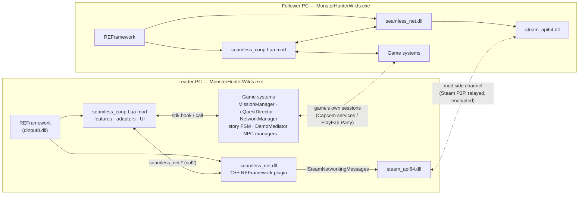
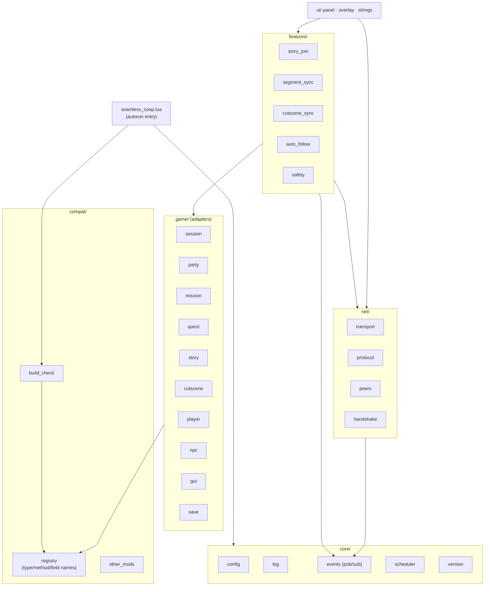
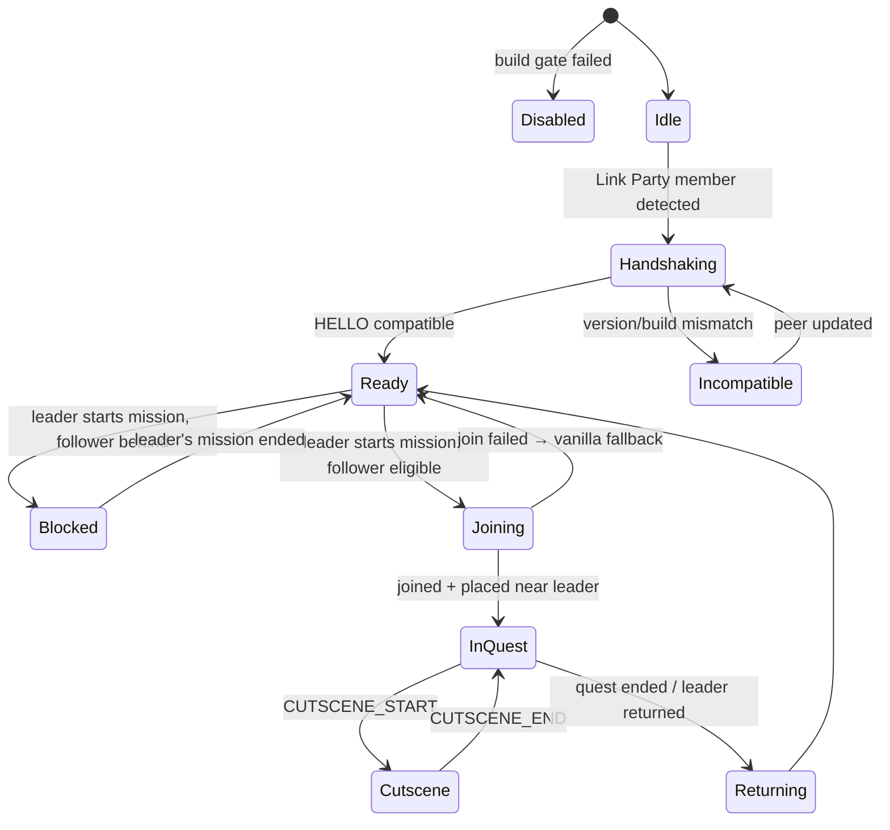
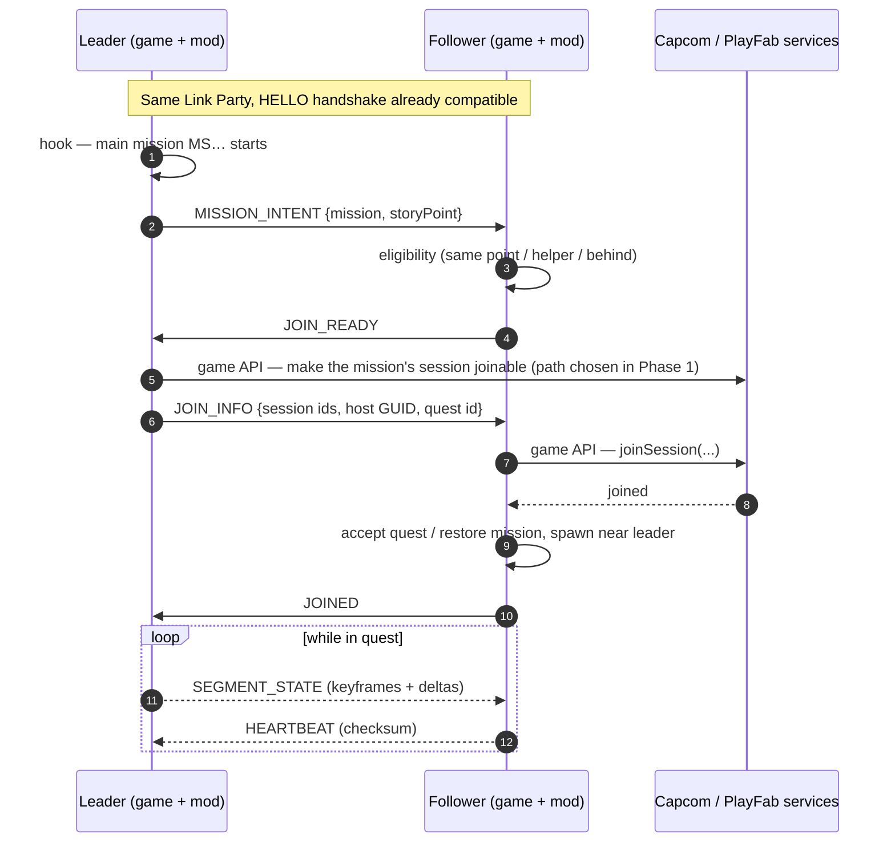
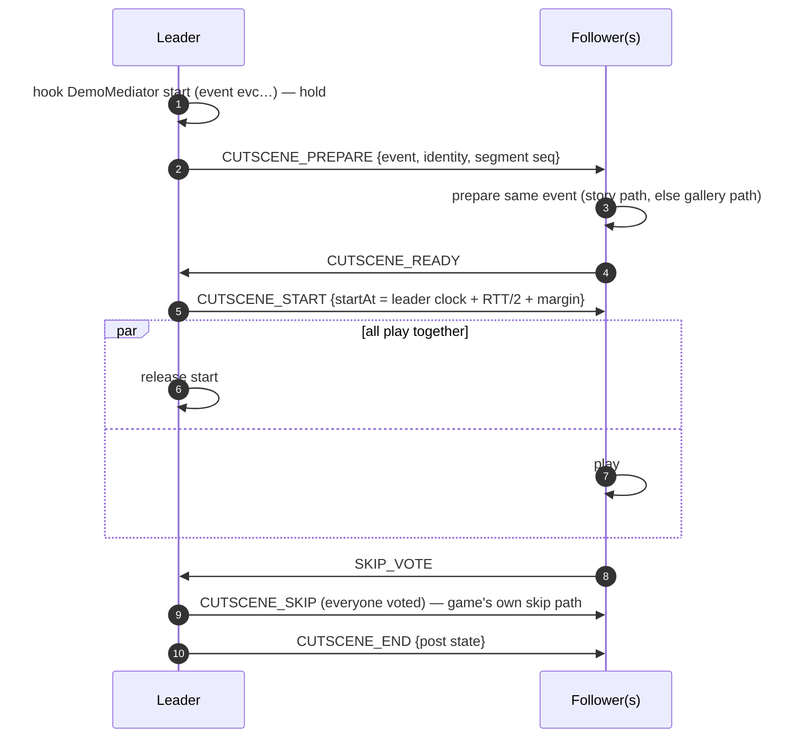

# Seamless Co-op for Monster Hunter Wilds — Implementation Plan

> Status: **Draft v0.1** (2026-10-21). Implements the [feature spec](feature-spec.md); grounded in [research](research/00-research-summary.md).
> Diagrams use Mermaid (rendered by GitHub).

## 1. Approach in one paragraph

Build the mod on **REFramework**, which already injects into Wilds, defeats its integrity checks and exposes the
managed type system by name. **Lua scripts** (REFramework autorun) hold all gameplay logic and UI. A **small C++
REFramework plugin** (`seamless_net.dll`) provides what Lua cannot: a mod-to-mod **side channel over Steam P2P**,
using the game's own `steam_api64.dll`, plus file access outside the Lua sandbox for save backups. The **leader's game
is authoritative**: it broadcasts story/quest/cutscene events, and followers mirror them using the **game's own
functions**. No game file is modified and quest data is never altered. Work starts with a **reverse-engineering spike**
against the live game, using praydog's `re-engine-mcp`, to replace hypotheses with facts before features are built.

## 2. Key decisions

| ID | Decision | Rationale | Alternatives rejected |
|---|---|---|---|
| D1 | **REFramework** is the runtime platform. | Proven on Wilds (users already run it). It handles injection, integrity bypass, reflection, hooks, ImGui and hot reload. Wilds mods use it. | Standalone proxy DLL like MHW's mod: re-implements the integrity bypass and needs raw offsets; much more fragile. |
| D2 | **Lua for logic/UI; C++ plugin only for the side channel, native access and file I/O outside the sandbox.** | Lua gives hot reload and fast iteration, and end users need only REFramework. | C# REFramework.NET: every player would need nightly REFramework plus the C# API. C# is used only for dev tooling (re-engine-mcp). |
| D3 | **Side channel = Steam Networking Messages** (P2P through Valve's relay), resolved at runtime from the game's `steam_api64.dll` flat exports. | Encrypted, NAT-traversing, no servers to run. Wilds PC players all have Steam. ER Seamless uses Steam networking too. | Own relay server (infrastructure and privacy cost). Game chat abuse (visible, moderated, rate-limited) is kept only as a bootstrap fallback. |
| D4 | **Leader-authoritative event model.** | Matches how ER/MHW mods avoid divergence; one source of truth for story state. | Peer consensus (complex, slow). |
| D5 | **No game file modification.** | Avoids PAK-integrity issues and Capcom's modified-quest detection. Simple install and uninstall. | PAK/user-file edits. |
| D6 | **All game names in one validated registry; fail closed.** | Title updates rename or remove methods. The mod must detect this and disable itself rather than misbehave. | Scattered `sdk.find_type_definition` calls. |
| D7 | **Open source (MIT); no packers; disclose AI assistance.** | Online-mod trust (MHW mod drew security concerns); AV false positives. | Closed source. |
| D8 | **Same-story-point policy** (spec F1.2). | The safest scope. Followers earn progress the way the game already grants it. | Writing story flags for players who are behind. |

## 3. Architecture



Two independent links connect the PCs. The **game's own** sessions keep doing what they do: player replication,
monsters, quest sessions, chat. The **mod side channel** only carries small coordination messages (who is modded,
story point, "starting mission X", cutscene barrier/skip votes, objective/NPC state).

## 4. How the game is (not) modified

| Asset | What we do |
|---|---|
| Game executable, PAKs, natives | **Nothing.** No patches, no PAK or loose-file edits. |
| `<game>\dinput8.dll` | REFramework's loader (a prerequisite, installed by the user). |
| `<game>\reframework\autorun\` | Our Lua: `seamless_coop.lua` (entry) + `seamless_coop\**`. |
| `<game>\reframework\plugins\` | Our native plugin `seamless_net.dll`. |
| `<game>\reframework\data\seamless_coop\` | Config, logs, save backups (the only folder REFramework Lua may write). |
| Save files (`<Steam>\userdata\<id>\2246340\remote\win64_save`) | **Read-only**: copied by the plugin at launch for backups; the game alone writes saves. |
| Runtime behaviour | Hooks on managed methods (`sdk.hook`) and calls to game functions. Native hooks only if unavoidable (safetyhook via the plugin). |

Uninstall = delete our files. Fluffy Mod Manager can install the release zip (it is just a `reframework\` tree).

## 5. Repository layout

```
mhwilds-seamless-coop/
├─ docs/                      feature-spec, implementation-plan, research/, re/ (game model), testing/
├─ src/
│  ├─ lua/
│  │  ├─ seamless_coop.lua    REFramework autorun entry: bootstraps modules, build gate
│  │  └─ seamless_coop/
│  │     ├─ core/             config, log, events (pub/sub), scheduler (frame/timer tasks), util, version
│  │     ├─ compat/           registry (every app.* type/method/field we use) + build_check, other_mods
│  │     ├─ game/             adapters: session, party, mission, quest, story, cutscene, player, npc, gui, save
│  │     ├─ net/              transport (seamless_net or loopback), protocol (encode/validate), peers, handshake
│  │     ├─ features/         story_join, segment_sync, cutscene_sync, auto_follow, safety
│  │     └─ ui/               panel, overlay, strings/en.lua
│  └─ plugin/                 C++20 REFramework plugin (CMake): Steam P2P, Lua bindings, save backup, log sink
├─ tests/
│  ├─ lua/                    offline unit tests for pure modules (Lua 5.4 runner built via CMake)
│  └─ plugin/                 Catch2 tests (framing, validation, rate limits)
├─ re/                        probe scripts, traces, notes from the RE spike (no game data committed)
├─ tools/
│  ├─ setup/                  install-toolchain.ps1, install-ghidra.ps1
│  ├─ deploy.ps1              copy Lua + DLL into <game>\reframework (dev)
│  ├─ package.ps1             build the release zip
│  └─ web-research/           Playwright page reader used for research
├─ types/                     generated LuaLS type stubs from il2cpp_dump.json (gitignored, regenerated locally)
├─ .mcp.json                  project MCP servers (re-engine-mcp, GhidraMCP)
├─ .github/lsp.json           clangd + lua-language-server
└─ .luarc.json                LuaLS config with REFramework globals
```

## 6. Lua mod design

### 6.1 Module structure



- **Adapters (`game/`)** are the only code that touches `sdk.*`. Each exposes intention-revealing functions
  (`mission.current_main_mission()`, `story.point()`, `cutscene.on_start(cb)`, `session.join(info)`) and **events**
  (`mission_started`, `segment_changed`, `cutscene_started`, `quest_cleared`, …). If game internals change in a title
  update, only adapters and the registry change.
- **Registry (`compat/registry.lua`)** lists every type, method signature and field we use, tagged by feature. At
  startup `build_check` resolves all of them. A feature whose entries fail is disabled. If core entries fail, the mod
  disables itself and installs no hooks (spec F5.1).
- **Events + scheduler:** hooks do minimal work (capture args, emit an event). Logic runs from `re.on_frame` via the
  scheduler, so it is never inside a game call stack. Everything runs under `pcall` with per-feature fault counters (spec F5.6).
- **Features** are independent state machines that subscribe to adapter/net events, and each can be toggled.

### 6.2 Follower state machine (per follower, mirrored by the leader per member)



## 7. Native plugin design (`seamless_net.dll`)

- **Scaffold:** start from the REFramework plugin pattern (`reframework_plugin_initialize`, `on_lua_state_created`). Use
  [Prof9/REF-Plugin-Template](https://github.com/Prof9/REF-Plugin-Template) or praydog's `examples/example_plugin`.
  REFramework headers, sol2 and Lua come from the pinned REFramework commit (nightly-01433 `d4611ae`) via CMake
  FetchContent. **The Lua version must match REFramework's.**
- **Lua API** (registered into REFramework's Lua state under `API::LuaLock`):
  ```lua
  seamless_net.version()                       -- plugin + protocol version
  seamless_net.local_id()                      -- own SteamID64 as string
  seamless_net.send(steam_id, payload, reliable) -> ok, err
  seamless_net.poll(max)                       -- { {from=steam_id, data=payload}, ... }
  seamless_net.close(steam_id)
  seamless_net.backup_saves(keep) -> ok, info   -- copies win64_save to reframework/data/seamless_coop/save_backups
  seamless_net.status()                        -- relay/session diagnostics
  ```
- **Steam binding:** at init, `GetModuleHandle("steam_api64.dll")`, then resolve the **flat API** exports by name. Probe
  interface versions present in the game's DLL:
  `SteamAPI_SteamNetworkingMessages_SteamAPI_v00x`, `SteamAPI_ISteamNetworkingMessages_SendMessageToUser`,
  `…_ReceiveMessagesOnChannel`, `…_CloseSessionWithUser`, `SteamAPI_SteamNetworkingMessage_t_Release`,
  `SteamAPI_SteamNetworkingIdentity_SetSteamID64`, `SteamAPI_SteamUser_v0xx` + `SteamAPI_ISteamUser_GetSteamID`.
  We declare only these signatures ourselves; **no Steamworks SDK files are redistributed**. A missing export (e.g. a
  DLC unlocker replaced the DLL) disables the channel with a clear message, as MHW's mod learned.
- **Threading:** all calls happen on the game thread from Lua (`poll` each frame, non-blocking). There are no background
  threads, except the save backup which runs once on a worker thread at plugin load.
- **Validation:** payload ≤ 4 KB; senders must be on the Lua-provided allow-list (verified party members); per-peer rate limiting.
- **Build:** CMake + Ninja + MSVC v143 (VS 2022 Build Tools), C++20, `/W4`, static CRT, no packers. Reproducible release builds in CI.

## 8. Mod protocol

JSON objects (REFramework's `json` module) wrapped in a small envelope:
`{ "p": <protocol>, "t": "<type>", "s": <seq>, "m": <mission seq>, "d": { … } }`.

| Type | Direction | Payload (main fields) | Purpose |
|---|---|---|---|
| `HELLO` / `HELLO_ACK` | both | mod version, protocol, game build, REFramework rev, hunter GUID, story point, settings that matter | Handshake & compatibility (spec F5.2). |
| `HEARTBEAT` | both, ~1 Hz | state (idle/joining/in-quest/cutscene), mission ID, segment seq, checksum, send time + echoed peer time | Liveness, desync detection, **RTT and clock-offset estimate** (peers may be on different continents). |
| `MISSION_INTENT` | leader → all | mission ID, story point, quest/session info as available | "I am starting this story quest". |
| `JOIN_READY` / `JOIN_REFUSED` | follower → leader | eligibility result & reason | Spec F1.2. |
| `JOIN_INFO` | leader → follower | session identifiers needed by the game's join call | Drives the game's own join. |
| `JOINED` / `LEFT` | follower → leader | — | Membership in the leader's quest. |
| `SEGMENT_STATE` | leader → all | FSM step/flags, objectives, NPC anchors, zone | Spec F2 (keyframes + deltas). |
| `TRIGGER_REQUEST` | follower → leader | trigger ID | Spec F2.6 (P2). |
| `CUTSCENE_PREPARE` / `READY` / `START` / `SKIP_VOTE` / `SKIP` / `END` | mixed | event ID + identity, scheduled start time (leader clock), votes, post-state | Spec F3. `START` schedules playback ahead by half the worst RTT plus a margin, so peers start together. |
| `CATCH_UP` | leader → follower | leader position/area | Spec F2.2. |
| `NOTICE` | any | code + params (localized client-side) | Panel messages. |





## 9. Feature implementation approach

The research narrows what to hook, but the **mechanism of the story gate is unconfirmed** until Phase 1. Two working
hypotheses decide the design:

- **H1 — "early quest session":** a story mission already has (or can cheaply create) a quest session from its start.
  Only *joinability* is gated: SOS/Link-invite disabled, join-side "cutscene seen" checks, `QUEST_JOIN_DENY`. Then F1 is
  mostly *relaxing checks for verified modded members* and using the BetterSoS-proven join path
  (`NetworkRequestManager.joinSession` → `MissionManager.getQuestDataFromMissionId` → `cQuestDirector.acceptQuest`).
- **H2 — "field first, quest at the gate":** pre-gate segments run as **field content** (each player's own field
  instance; shared only through Environment Link). The quest session is created at the gate. Link Party sync is
  explicitly broken by story events (`Net_Party.PARTY_SYNC_OPTION.LEAVE_StoryEvent`). Then F1/F2 means keeping the party
  in a **shared field instance** through the story event. Each same-point follower runs its own copy of the mission in
  **lockstep**, driven by the leader's `SEGMENT_STATE` (the approach MHW's mod converged on in 1.6). At the gate, we
  transition everyone into the leader's quest session automatically.

| Feature | Approach | Candidate hook points / APIs (from research — verify) |
|---|---|---|
| **F1 story join** | Detect the leader's main-mission start, check eligibility, then join through the game's own functions. Under H1, relax join gates for verified members. Under H2, keep the shared environment through the story event and auto-transition at the gate. | `app.MissionManager` (mission start/activation, `getQuestDataFromMissionId`, `get_QuestDirector`), `app.cQuestDirector.acceptQuest/goQuest`, `app.NetworkRequestManager.{searchSession,joinSession,leaveSession}`, `app.net_quest_session.cJoinQuestSessionInfo`, `app.Net_QuestUserInfo.QuestJoinStatus` (incl. `LATEJOIN_WAIT`), `app.Net_LateJoinSync`, `app.Net_Party` (`LEAVE_StoryEvent`), `app.NetworkRequest.TYPE.INVITE_LINKPARTY_QUEST/…_SYNC`, `app.net_session_manager.SESSION_KICK_REASON.QUEST_JOIN_DENY`, `app.GUIFlowQuestCounter`, `app.cGUICreateQuestSessionHelper`. |
| **Story point** | Compare main-mission progress (current mission ID and relevant story package flags) read through game getters. | `app.StoryPackageFlag`, `app.StoryFlagList`, `app.MissionManageID`, `app.SaveDataManager.getCurrentUserSaveData` → `app.savedata.*`. |
| **F2 segments** | Keep remote players visible (neutralize `DRAWOFF_REPLICA_PLAYER` for the modded party). Make story NPCs host-authoritative (`cNpcNetworkMasterManager` `HOST`). Leader broadcasts objective/FSM keyframes; followers apply them through game setters. Mission-halt zones are relaxed for followers, with catch-up when they fall behind. | `app.cStoryFsmController`, `app.StoryFsmDef.*_CONTINUE_TYPE`, `app.fsm_action.StoryActionBase`/`fsm_condition.StoryCondictionBase`, `app.MissionController` (`PHASE`, `OBJECTIVE_STATE`), `app.cMissionHaltController` (`HALT_TYPE`), `app.DialogueManager`, `app.GUI020400.SubtitlesData`, `app.cNpcNetworkMasterManager`, `app.NpcManager`. |
| **F3 cutscenes** | Hook the leader's cutscene start, run the barrier protocol, start the same event on followers (story path when at the same point, else the gallery path), and skip via the game's own skip. | `app.DemoMediator` (`onPlayStart`, `get_CurrentTimelineEventID`, `requestSkip`, `notifyCutSkipEnd`, `unload`, `endEndFsm`), `app.TimelineEventDefine.ID` (`evc…`), `app.CutSceneGalleryManager` (`STATE` pipeline), `TimelineEventDefine.EVENT_OTHERCHARA_DISP_ATTRIBUTE`. |
| **F4 auto-follow** | Auto-accept Link Party quest invites, or join via the leader's session info. Leader's start point is passed along. Joins are queued while the follower is in a menu or dialogue. | `app.GUIManager.{acceptQuestFromSearchResult,setQuestOrderParam}`, `app.cQuestAcceptArg` (`cStartPointInfo`), `app.cGUIQuestOrderParam`, Link Party invite requests, GUI open-state checks. |
| **F5 safety** | Registry-based build gate, handshake, plugin save backup, eligibility guards, `pcall` + fault counters, kill switch. Logs go through the plugin with a privacy filter. | `via.Application`/build info, REFramework `reframework:get_commit_hash()`, Steam account ID for the save path. |
| **F6 panel** | `re.on_draw_ui` section + `imgui` overlay window; strings table. | REFramework `imgui`, `re.on_frame`. |

## 10. Phase 1 — reverse-engineering spike (read-only)

**Tools:** re-engine-mcp (live type/object explorer and method calls from Copilot CLI), REFramework Object Explorer
and **Dump SDK** (`il2cpp_dump.json`), the enum dump (`Enums_Internal.hpp`), Lua **probe scripts** (`re/probes/*.lua`,
which log calls/args/returns of selected methods to a trace file), BetterSoS/WetU code as references, and Ghidra +
GhidraMCP (+ `ree-pdb` symbols from the dump) only for native functions.

| ID | Question | Method | Done when |
|---|---|---|---|
| R1 | What is the lifecycle of a story mission, from start through segments, gate, hunt, clear and return? | Probe `MissionManager`/`MissionController`/`cStoryFsmController`/`cQuestDirector`/`DemoMediator` across 2–3 story quests solo; save timestamped traces. | A documented timeline per quest, with the methods/events that mark each transition. |
| R2 | Which session types are active before and after the gate (H1 vs H2)? | Read `NetworkManager`/`SessionManager` state and `getUserInfoList(type)` during each segment. | H1 or H2 confirmed. |
| R3 | Which checks block SOS / Link-invite / join before the gate, and which reject joiners ("cutscene not seen", `QUEST_JOIN_DENY`)? | Trace the GUI flow for "Post/Join quest" and SOS. Locate predicates; test toggling them locally (solo, no join yet). | The list of predicates and where each is evaluated (client vs server response). |
| R4 | How do we compute a comparable story point? | Inspect save data/story flag accessors on two saves at known points. | A `story.point()` design with test vectors. |
| R5 | Can we get each Link Party member's Steam ID (or another stable ID) in-game? | Inspect `Net_UserInfoManager`/`Net_UserInfo`/member list (`MemberListDef.Category.Platform`, `PLATFORM_PROFILE`). | Side-channel addressing confirmed, or the fallback chosen (Steam friends rich presence, then chat bootstrap). |
| R6 | How do the story FSM and NPCs behave with remote players present (env link)? | Two-PC: Environment Link, leader starts a story mission; observe `LEAVE_StoryEvent`, NPC master selection, `DRAWOFF_REPLICA_PLAYER`. | Documented behaviour, plus the minimal set of overrides needed. |
| R7 | How do we start/skip a specific cutscene on demand? | Experiment with `DemoMediator` and the gallery pipeline in single-player. | A reliable "play event X / skip" recipe with no audio or input leftovers. |
| R8 | Does the server reject anything (Q1)? | Two-PC private Link Party: minimal early-join experiment on one story quest after R3. | Observed errors/kicks (or none) recorded. Go/no-go for the H1/H2 path. |

**Phase 1 output:** `docs/re/game-model.md` (answers Q1–Q8 with evidence), `re/traces/` (sanitized), an updated
registry draft, and a decision record "H1 vs H2". **If both H1 and H2 prove infeasible** because the server enforces the
gate, fall back to the **"seamless regroup"** scope. Everyone plays segments in a shared environment with mirrored story
events (lockstep), and the mod automates the vanilla regroup at the gate. That is still a large UX win.

## 11. Development workflow

- **Build:** `cmake --preset release` → `ninja` builds `seamless_net.dll` and the Lua test runner.
- **Deploy (dev):** `tools/deploy.ps1` copies `src/lua/**` to `<game>\reframework\autorun\` and the DLL to
  `<game>\reframework\plugins\`. It writes only inside `reframework\` (user-approved scope) and refuses to replace the
  DLL while the game runs. Lua changes hot-reload via REFramework's **Reset Scripts**.
- **Live inspection:** start the game (REFramework nightly + C# API) → re-engine-mcp listens on `localhost:8899` →
  start Copilot CLI **inside the repo** so the project `.mcp.json` loads → use the `reframework` tools (read-only first).
  re-engine-mcp is **dev-only**: it can call any game method (including sending chat), so remove its plugin source from
  `reframework\plugins\source\` before normal online play.
- **Two-player testing:** PC-B is a **remote tester's laptop in another country**, and we have no remote access to it.
  Builds reach it as GitHub pre-releases plus a tester kit (install, uninstall, collect logs). Sessions are short,
  scheduled and scripted. Single-PC work comes first. See [remote-testing.md](testing/remote-testing.md).
- **Code quality:** LuaLS diagnostics (`.luarc.json`), clangd/clang-tidy for C++, StyLua formatting, and a review pass per change.

## 12. Testing strategy

| Level | What | How |
|---|---|---|
| Unit (offline) | Protocol encode/validate, eligibility rules, state machines, registry resolution logic | Lua 5.4 runner (official Lua source built by CMake) + a tiny assertion lib; Catch2 for plugin framing/rate limits. |
| In-game, single PC | Adapters, hooks, panel, build gate, cutscene recipes | **Loopback transport** ("fake peer" that replays recorded messages) + probe scripts + debug panel. |
| Remote two-player sessions | Side channel, F1–F4 end-to-end | Scheduled sessions S0–S3+ with the remote tester ([remote-testing.md](testing/remote-testing.md)); checklists per story quest in `docs/testing/story-matrix.md` (quest × feature × result × notes); logs from both PCs. |
| Regression | After every title update or REFramework update | Build gate + smoke checklist (join, segment, cutscene, hunt, return) on 3 representative quests. |
| Fault injection | Disconnects, menus open, late join, version mismatch, missing exports | Debug toggles in the panel. |

## 13. Roadmap

| Phase | Goal | Exit criteria |
|---|---|---|
| **0 · Foundations** *(done)* | Toolchain, REFramework nightly + C# API, re-engine-mcp, Ghidra/GhidraMCP, LSP, research & planning docs, GitHub repo | ✅ Game boots with the new REFramework; re-engine-mcp answers live queries; repo public at `Hunterjet/mhwilds-seamless-coop`. Carried into Phase 1: SDK dump + LuaLS stubs. |
| **1 · RE spike** | Answer R1–R8. Single-PC first, then sessions S0/S1 with the remote tester (tester kit v0) | `docs/re/game-model.md` + H1/H2 decision + registry draft. |
| **2 · Skeleton & side channel** | Lua skeleton (core/compat/net/ui), `seamless_net.dll`, handshake, heartbeat, panel party view, loopback transport, kill switch | Two PCs show each other as "modded · compatible"; messages round-trip; a forced build mismatch disables cleanly. |
| **3 · F1 MVP** | Seamless join for **one** Chapter 1 story quest end-to-end; eligibility; late join; save backups | Spec F1 acceptance on that quest; both saves progress correctly. |
| **4 · F2 segments** | Presence, travel catch-up, dialogue, objectives, NPC sync | Spec F2 acceptance on representative quests of Ch. 1–2. |
| **5 · F3 cutscenes** | Barrier, start, vote-skip, end recovery; per-cutscene notes | Spec F3 acceptance on 5+ cutscenes. |
| **6 · F4 + Low Rank** | Auto-follow/return, start point, join queueing; full **Low Rank** (Ch. 1–3) with 2 players | LR completed seamlessly; compatibility table for LR. |
| **7 · High Rank & hardening** | Ch. 4–6 + title-update story assignments, 3–4 players, perf, fault injection, string externalization | Spec §12 release criteria met. |
| **8 · Release & maintenance** | Packaging, Nexus + GitHub releases, CI, docs, title-update playbook; plan Ascendance support | v1.0 published; playbook rehearsed on one update. |

## 14. Packaging, release and maintenance

- **Zip layout:** `reframework/autorun/seamless_coop.lua`, `reframework/autorun/seamless_coop/**`,
  `reframework/plugins/seamless_net.dll`, plus `README` and `LICENSE`. Installs by extracting into the game folder or via
  Fluffy Mod Manager.
- **Versioning:** SemVer for the mod; a **protocol version** for the side channel; a compatibility table
  (game build ↔ REFramework revision ↔ mod version) in the README and in `compat/` for the build gate.
- **CI (GitHub Actions, windows-latest):** build the plugin, run Lua and C++ tests, package the zip, attach it to the release. No obfuscation; reproducible builds.
- **Title-update playbook:** (1) the mod self-disables on the new build; (2) update REFramework; (3) re-dump the SDK;
  (4) run the registry validator, fix renamed entries in `compat/registry.lua`; (5) smoke tests; (6) release and bump the
  compatibility table.

## 15. Risks and mitigations

| Risk | Impact | Mitigation |
|---|---|---|
| Story gate enforced server-side | F1 as specified impossible | Phase 1 R3/R8 before building. Fallback "seamless regroup" scope (§10). |
| **Account bans** (Capcom suspends for modified quest data / play history) | User harm | Never change quest data/rewards. Only game APIs. Private Link Party testing. Plain-language risk statement. Kill switch. Open source. |
| Title updates rename/remove methods | Mod breaks | Registry + build gate; reflection by name; fast playbook; self-disable instead of misbehaving. |
| Steam IDs not readable in-game | No side channel | Fallbacks: Steam friends rich presence, then a one-time game-chat bootstrap. |
| Story FSM desync / soft-locks | Stuck players | Leader authority, keyframes + checksums, catch-up, watchdog timeouts, kill switch, save backups. |
| Save corruption | Severe | The mod never writes saves; backups at launch; progress guards. |
| Cutscene audio/input glitches (as in MHW 1.4–1.6) | Poor UX | Use the game's own skip/end paths; per-cutscene test matrix. |
| REFramework changes (API, Lua version) | Build/runtime breaks | Pin a tested nightly; CI builds against the pinned commit; compatibility table. |
| Antivirus false positives on the DLL | Install friction | Open source, no packers, CI-built, consistent signing metadata. |
| Single maintainer burnout (ER lesson) | Project stalls | Documented architecture, small modules, contributor guide, automation. |
| Remote tester only (other country, no remote access, time zones) | Slow two-player feedback | Single-PC work first; loopback transport; short scripted sessions; tester kit automates install, uninstall and log collection; logs from both PCs. |
| Performance | FPS loss | Event-driven hooks, no heavy per-frame work, profiling in Phase 7. |

## 16. Tooling inventory (installed 2026-10-21)

| Tool | Where | Use |
|---|---|---|
| VS 2022 Build Tools (MSVC 14.44), CMake 4.4, Ninja 1.13 | system | Build `seamless_net.dll` and the test runner |
| Python 3.13, .NET SDK 10.0.402, OpenJDK 21 | system | Scripts, re-engine-mcp server, Ghidra |
| clangd 23, lua-language-server 3.19 | system; `.github/lsp.json` | Code intelligence for Copilot CLI |
| REFramework nightly-01433 + C# API | game folder (backup + revert manifest in `reframework\backups\`) | Runtime + dev C# plugins |
| praydog/re-engine-mcp | `C:\src\re-engine-mcp`; plugin in `reframework\plugins\source\`; `.mcp.json` → `reframework` | Live game inspection by the agent |
| Ghidra 12.1.4 + GhidraMCP 2.0 | `C:\src\_tools\`; bridge venv `C:\src\_tools\ghidra-mcp-venv`; `.mcp.json` → `ghidra` | Native RE when needed (enable GhidraMCPPlugin in CodeBrowser) |
| Context7, Microsoft Learn MCP | user-level MCP | Up-to-date library / Win32 / MSVC docs |
| Trail of Bits `modern-cpp` skill | Copilot plugin | C++20/23 guidance |
| Playwright page reader | `tools/web-research/` | Low-volume research (Nexus, Reddit) with a fresh, isolated browser profile |

## 17. Appendix — reference implementations to study (do not copy unlicensed code)

- `kmy0/BetterSoS` (no licence file — read only): quest search/join pipeline and Lua typedef style.
- `WetU/MHWs_REF_Scripts`: `app.DemoMediator` cutscene control (auto-skip).
- `praydog/re-engine-mcp` (MIT): live object graph navigation; C# plugin patterns.
- `praydog/REFramework` (MIT): plugin API, `IntegrityCheckBypass`, Object Explorer dump.
- `GreenComfyTea/MHR-Better-Matchmaking` (MIT, Rise): session-manager hooking patterns.
- `kagenocookie/REFDumpFormatter`: `il2cpp_dump.json` → Lua typedefs for LuaLS.
- `kvasszn/ree-pdb`: `il2cpp_dump.json` → PDB for Ghidra/x64dbg.
